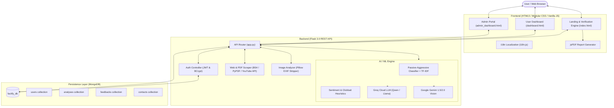

# 🛡️ Factify — AI-Powered Fake News & Misinformation Detector

<div align="center">

[](https://www.python.org/)
[](https://flask.palletsprojects.com/)
[](https://scikit-learn.org/)
[](https://www.mongodb.com/)
[](https://ai.google.dev/)
[](https://groq.com/)
[-brightgreen.svg?logo=checkmarx&logoColor=white)](tests/system_verification.py)
[](LICENSE)

**Verify Before You Believe.** An end-to-end, multi-modal intelligence platform that detects fake news, emotional manipulation, propaganda, and clickbait in real-time.

[Key Features](#-key-features) • [System Architecture](#-system-architecture) • [Project Structure](#-project-structure) • [Installation & Run](#-installation--quick-start) • [API Reference](#-api-reference) • [Testing & Verification](#-testing--quality-assurance)

</div>

---

## 📖 Table of Contents

- [Overview](#-overview)
- [Key Features](#-key-features)
- [System Architecture](#-system-architecture)
- [Project Structure](#-project-structure)
- [Tech Stack](#-tech-stack)
- [Installation & Quick Start](#-installation--quick-start)
  - [1. Prerequisites](#1-prerequisites)
  - [2. Environment Setup & Dependencies](#2-environment-setup--dependencies)
  - [3. Configure Environment Variables](#3-configure-environment-variables)
  - [4. Seed Database & Admin Account](#4-seed-database--admin-account)
  - [5. Run the Application](#5-run-the-application)
- [Production Build & Deployment](#-production-build--deployment)
- [Model Training (Optional)](#-model-training-optional)
- [API Reference](#-api-reference)
- [Testing & Quality Assurance](#-testing--quality-assurance)
- [Security Features](#-security-features)
- [Future Roadmap](#-future-roadmap)
- [License](#-license)

---

## 🌟 Overview

In the era of viral media and automated content generation, misinformation poses severe challenges to public trust, democratic institutions, and civic discourse. 

**Factify** is an enterprise-grade fact-checking and media forensics suite engineered to help individuals, journalists, and researchers identify fake news, emotional bias, and manipulated media within seconds. Factify combines statistical Machine Learning classifiers with state-of-the-art Large Language Models (Groq Cloud LLMs) and Multimodal Vision APIs (Google Gemini) to deliver granular authenticity reports, credibility scores, and verifiable audit certificates.

---

## ✨ Key Features

### 1. 🔍 Multi-Modal Verification Engine
- **Text & Claims Analysis**: Paste any news snippet, statement, or headline to inspect factual veracity, sensationalism, and propaganda language.
- **Automated Web Scraping (URL Engine)**: Input web links (articles, blogs, YouTube transcripts, or Reddit threads) for automated extraction and live domain reputation checking.
- **Document & PDF Scanning**: Extract and analyze plain text and PDF publications.
- **Visual Misinformation & OCR (Image Verification)**: Upload infographics, screenshots, or headlines. Powered by **Google Gemini** and **Groq Vision**, Factify strips EXIF metadata, extracts embedded claims, performs deep fact-checking, and calculates image trust modifiers.

### 2. 🧠 Dual-Tier Machine Learning & NLP Pipeline
- **Passive-Aggressive Classifier & TF-IDF**: Trained on 40,000+ real and fake news articles for high-speed statistical text classification.
- **Emotional Manipulation & Sentiment Radar**: Identifies hyper-partisan phrasing, fear-mongering, and outrage-triggering patterns.
- **Clickbait & Sensationalism Detector**: Scans against curated clickbait syntax and sensational expressions.
- **Suspicious Sentence Highlighting**: Pinpoints exact sentences within the input that triggered suspicion.
- **Curated Domain Reputation Registry**: Cross-checks web origins against verified reputable news publishers and known conspiracy/disinformation domains.

### 3. 👤 User Dashboard & History
- Secure JWT-based user authentication (Sign Up / Sign In) with BCrypt password hashing.
- Personal analytics dashboard tracking total verifications, real vs. fake distribution, and saved audit logs.

### 4. 🛠️ Dedicated Admin Portal
- Real-time platform usage metrics, user accounts administration, verification activity logs, and user feedback moderation.

### 5. 📄 Verifiable Exportable PDF Reports
- Generates official, tamper-evident PDF verification certificates complete with unique Document IDs (`FG-XXXXXX`), timestamps, credibility meters, and factor-by-factor breakdowns.

### 6. 🌐 Modern UI & Accessibility
- **Glassmorphic Cyber Aesthetic**: High-performance UI with animated particle canvas background.
- **Dark / Light Theme**: Seamless toggle with persistent user preference storage.
- **Multilingual Support (i18n)**: Instant localized interfaces in **English**, **Spanish**, **Hindi**, and **French**.
- **Voice Input (Speech-to-Text)**: Browser Web Speech API integration for hands-free audio queries.
- **Factify AI Assistant**: Floating interactive chatbot powered by Groq Cloud to guide users on fact-checking methodologies.

---

## 🏗️ System Architecture



---

## 📁 Project Structure

```
Fake News Detector/
├── backend/
│   ├── dataset/                # Training datasets (Fake.csv, True.csv) (.gitkeep)
│   ├── temp_uploads/           # Secure temporary staging for uploads (.gitkeep)
│   ├── .env                    # Local secrets (excluded from Git)
│   ├── .env.example            # Environment variables configuration template
│   ├── app.py                  # Main Flask application & REST endpoints
│   ├── image_analyzer.py       # OCR, Vision fact-checking (Gemini / Groq) & EXIF scrubbing
│   ├── model.py                # AI Model logic, TF-IDF vectorization & domain heuristics
│   ├── requirements.txt        # Backend Python dependencies
│   ├── train.py                # Script to retrain the ML classifier
│   ├── setup_admin.py          # Admin account creation & database initialization
│   ├── reset_db.py             # Database sanitation utility
│   └── migrate_db.py          # Database schema migration utility
│
├── frontend/
│   ├── assets/                 # Static media assets and branding icons (.gitkeep)
│   ├── index.html              # Main landing page & verification interface
│   ├── dashboard.html          # Authenticated user dashboard & scan history
│   ├── admin_dashboard.html    # System administration portal
│   ├── base.css                # Global styles, variables, typography, and reset
│   ├── components.css          # Reusable UI component styling (cards, badges, modals)
│   ├── style.css               # Main layout and animation styles
│   ├── user_dashboard.css      # User dashboard view styling
│   ├── admin.css               # Admin portal styling
│   ├── script.js               # Frontend controller, API calls & PDF engine
│   ├── admin.js                # Admin portal logic & analytics rendering
│   └── i18n.js                 # Multi-language dictionary & localization controller
│
├── tests/
│   ├── system_verification.py  # 36-point automated full-stack verification suite (100% Pass)
│   ├── test_api.py             # Comprehensive API integration test suite
│   ├── test_api_check.py       # Quick health & feature test runner
│   ├── qa_test_suite.py        # End-to-end user journey & QA test suite
│   ├── advanced_qa_suite.py    # Deep stress testing & accuracy benchmarks
│   └── audit_auth.py           # Role-based access control & JWT security audit
│
├── docs/
│   └── Presentation.txt        # Full project presentation script and slide notes
│
├── .gitignore                  # Git ignore rules (protects keys, datasets, venv, caches)
├── .env.example                # Root environment variables sample
└── README.md                   # Project documentation
```

---

## 💻 Tech Stack

| Domain | Technologies / Libraries |
| :--- | :--- |
| **Backend** | Python 3.9+, Flask 3.0+, Flask-CORS, PyMongo, PyJWT, BCrypt |
| **Machine Learning** | Scikit-Learn, Pandas, NumPy, TF-IDF Vectorizer, PassiveAggressiveClassifier |
| **Generative AI & Vision** | Google Gemini SDK (`google-genai`), Groq Cloud API (`groq`), Pillow (PIL) |
| **Web Scraping & NLP** | BeautifulSoup4, Requests, YouTube Transcript API |
| **Database** | MongoDB (Local service or MongoDB Atlas) |
| **Frontend** | Vanilla JavaScript (ES6+), HTML5, CSS3, Canvas API, jsPDF |

---

## 🚀 Installation & Quick Start

### 1. Prerequisites
- **Python 3.9+** installed (`python --version` or `py --version`).
- **MongoDB** running locally (`mongodb://localhost:27017/`) or a MongoDB Atlas URI.
- Free API keys:
  - [Groq Cloud](https://console.groq.com/) (for real-time LLM reasoning)
  - [Google AI Studio](https://aistudio.google.com/) (for Gemini Vision / OCR)
  - [GNews API](https://gnews.io/) (for live trending headlines, optional)

---

### 2. Environment Setup & Dependencies

```bash
# 1. Clone the repository
git clone https://github.com/your-username/Fake-News-Detector.git
cd Fake-News-Detector

# 2. (Optional) Create & activate a virtual environment
# Windows:
python -m venv venv
.\venv\Scripts\Activate.ps1
# macOS / Linux:
python3 -m venv venv
source venv/bin/activate

# 3. Install required packages
cd backend
pip install -r requirements.txt
```

---

### 3. Configure Environment Variables

Inside the `backend/` directory, create a `.env` file from the example:

```bash
# Windows:
copy .env.example .env

# macOS / Linux:
cp .env.example .env
```

Edit `backend/.env` with your actual API keys:

```ini
# AI Inference Services
GROQ_API_KEY=gsk_your_groq_api_key_here
GROQ_MODEL=qwen/qwen3.8-27b
GEMINI_API_KEY=your_google_gemini_api_key_here

# News Data API (Optional)
GNEWS_API_KEY=your_gnews_api_key_here

# Security & Authentication
JWT_SECRET=factify_super_secret_key_2026_prod

# Administrator Credentials (Used to seed the admin account)
ADMIN_EMAIL=admin@factify.com
ADMIN_PASSWORD=AdminSecure2026!

# Database Configuration
MONGODB_URI=mongodb://localhost:27017/
MONGODB_DB_NAME=factify_db
```

---

### 4. Seed Database & Admin Account

Run the provisioning script from the `backend/` directory to create the initial administrator profile:

```bash
python setup_admin.py
# Or on Windows using Python launcher:
py -3.14 setup_admin.py
```

> **Default Admin Credentials**:
> - **Email**: `admin@factify.com`
> - **Password**: `AdminSecure2026!`

---

### 5. Run the Application

Start the Flask application server:

```bash
cd backend
python app.py
# Or on Windows:
py -3.14 app.py
```

Once started, the unified server serves both the REST API and the frontend at:
- 🌐 **Main Application**: [http://127.0.0.1:5002](http://127.0.0.1:5002)
- 👤 **User Dashboard**: [http://127.0.0.1:5002/dashboard](http://127.0.0.1:5002/dashboard)
- 🛠️ **Admin Portal**: [http://127.0.0.1:5002/admin](http://127.0.0.1:5002/admin)

*(The frontend automatically routes all API requests to port `5002` even if served through a separate server like VS Code Live Server).*

---

## 📦 Production Build & Deployment

Factify includes an automated production build pipeline and enterprise-ready WSGI / container configurations.

### 1. Automated Release Packager
To compile, validate, and bundle the entire application into a release distribution:

```bash
python build.py
# Or on Windows:
py -3.14 build.py
```

This generates:
- 📁 **`dist/factify-release/`**: Self-contained production deployment folder.
- 🗜️ **`dist/factify-v1.0.0.zip`**: Portable release archive for cloud servers or GitHub Releases.
- 🚀 **`run_production.bat`** & **`run_production.sh`**: One-click production launchers.

---

### 2. Production WSGI Server (Waitress / Gunicorn)
Avoid running the development server in production. Factify provides a dedicated WSGI entrypoint (`backend/wsgi.py`):

- **Windows (Waitress)**:
  ```bash
  cd backend
  python wsgi.py
  ```
- **Linux / macOS (Gunicorn)**:
  ```bash
  cd backend
  gunicorn --bind 0.0.0.0:5002 --workers 4 --timeout 120 wsgi:app
  ```

---

### 3. Docker & Docker Compose Deployment
Deploy the full stack (Factify Application + MongoDB) with a single command:

```bash
# Build and start the containers
docker compose up --build -d

# Check running status
docker compose ps

# View live application logs
docker compose logs -f web
```
The application will be live at `http://localhost:5002` with persistent database storage in a Docker volume.

---

## 📊 Model Training (Optional)

Factify includes an active rule-based NLP heuristic engine that works immediately without serialized model weights. If you want to train the statistical machine learning model on custom data:

1. Download the **ISOT Fake News Dataset** (containing `Fake.csv` and `True.csv` from Kaggle).
2. Place `Fake.csv` and `True.csv` into the `backend/dataset/` directory.
3. Run the training script:
   ```bash
   cd backend
   python train.py
   ```
4. The pipeline will train the TF-IDF vectorizer and classifier, print accuracy metrics, and save `model.pkl` and `vectorizer.pkl` into `backend/`.

---

## 📡 API Reference

### Health & System
| Method | Endpoint | Auth | Description |
| :--- | :--- | :--- | :--- |
| `GET` | `/health` | None | System status, model status, and MongoDB health |

### Authentication (`/api/auth`)
| Method | Endpoint | Auth | Description |
| :--- | :--- | :--- | :--- |
| `POST` | `/api/auth/signup` | None | Register a new user (`name`, `email`, `password`) |
| `POST` | `/api/auth/login` | None | Authenticate credentials and receive JWT |
| `GET` | `/api/auth/me` | Bearer | Retrieve profile information of current user |

### Verification Engines
| Method | Endpoint | Auth | Description |
| :--- | :--- | :--- | :--- |
| `POST` | `/api/analyze-text` | Optional | Multi-tier claim credibility and sentiment analysis |
| `POST` | `/analyze-url` | Optional | Web scraping, domain verification, and article parsing |
| `POST` | `/api/analyze-image` | Optional | Multi-modal OCR, EXIF scrubbing, and image fact-checking |

### User Dashboard (`/api/user`)
| Method | Endpoint | Auth | Description |
| :--- | :--- | :--- | :--- |
| `GET` | `/api/user/analyses` | Bearer | Retrieve scan history for authenticated user |
| `DELETE` | `/api/user/analyses` | Bearer | Clear personal scan history |

### Admin Endpoints (`/api/admin`)
| Method | Endpoint | Auth | Description |
| :--- | :--- | :--- | :--- |
| `GET` | `/api/admin/stats` | Admin | System-wide statistics and metrics overview |
| `GET` | `/api/admin/users` | Admin | List registered user profiles |
| `DELETE` | `/api/admin/user/<id>` | Admin | Remove user account |
| `GET` | `/api/admin/feedbacks` | Admin | Retrieve user feedback and reviews |
| `DELETE` | `/api/admin/feedback/<id>` | Admin | Delete a feedback entry |
| `GET` | `/api/admin/contacts` | Admin | Retrieve customer contact inquiries |
| `GET` | `/api/admin/analyses` | Admin | View global verification audit logs |

### Assistant & Community
| Method | Endpoint | Auth | Description |
| :--- | :--- | :--- | :--- |
| `POST` | `/api/chat` | None | Conversational Q&A with Factify Assistant (Groq Cloud) |
| `GET` | `/api/news` | Bearer | Live cached trending news headlines |
| `POST` | `/api/feedback` | Bearer | Submit user review and ratings |
| `GET` | `/api/feedback` | None | Fetch public reviews for homepage display |
| `POST` | `/api/contact` | None | Submit user inquiry form |

---

## 🧪 Testing & Quality Assurance

Factify features a comprehensive test suite to ensure system reliability across all layers:

```bash
# Ensure server is running on http://127.0.0.1:5002

# 1. Complete 36-Point System Verification (Recommended)
python tests/system_verification.py
# (Or on Windows: py -3.14 tests/system_verification.py)

# 2. Quick API sanity check
python tests/test_api_check.py

# 3. Comprehensive Database & CRUD tests
python tests/test_api.py

# 4. Role-Based Access Control (RBAC) & Auth Audit
python tests/audit_auth.py

# 5. End-to-end user verification workflow
python tests/qa_test_suite.py

# 6. Stress benchmark & classification tests
python tests/advanced_qa_suite.py
```

### ✅ Verification Benchmark Results
The automated verification suite (`tests/system_verification.py`) validates **36 out of 36 checks (100% pass rate)**:
- [x] Health & Database Connectivity
- [x] HTML Delivery for Landing, User Dashboard, & Admin Dashboard
- [x] Static Assets Delivery (CSS & JS)
- [x] BCrypt Signup & JWT Login
- [x] Real & Fake Text NLP Classification
- [x] Emotion Radar, Manipulation & Clickbait Scoring
- [x] Web Scraping Engine
- [x] Authenticated Feedback & Contact APIs
- [x] User History Persistence
- [x] Live Groq Cloud AI Assistant
- [x] Admin Portal RBAC Access & Statistics
- [x] GNews Live Headlines Feed

---

## 🔒 Security Features

- **Isolated Credentials**: `.env` is ignored by `.gitignore` and protected with `.env.example` templates.
- **Cryptographic Password Protection**: User passwords are encrypted with salted **BCrypt**.
- **Stateless Authorization**: Secured endpoints require cryptographic **JWT** validation.
- **Role-Based Access Control (RBAC)**: Admin endpoints enforce strict role checks; regular user tokens receive HTTP 403 Forbidden.
- **Image Sanitization**: Uploaded images have EXIF GPS/camera metadata completely stripped before analysis to protect user privacy.
- **Temp Storage Hygiene**: Uploaded image buffers are saved in isolated UUID-named files in `temp_uploads/` and guaranteed to be deleted immediately upon analysis completion.
- **CORS Protection**: Restricted and controlled Cross-Origin Resource Sharing.

---

## 🔮 Future Roadmap

- [ ] **Browser Extension**: Real-time contextual fact-checking overlay for Chrome and Firefox.
- [ ] **Social Media Automation**: Direct verification bots for X (Twitter), Reddit, and WhatsApp.
- [ ] **Video Deepfake Detection**: Frame-by-frame visual artifact analysis for synthetic video manipulation.
- [ ] **Expanded Multi-lingual Models**: Dedicated regional NLP models for non-Latin script languages.

---

## 📄 License

This project is open-source and distributed under the [MIT License](LICENSE).

---

<div align="center">
  <b>Factify AI</b> — Empowering the digital world with truth and transparency.
</div>
